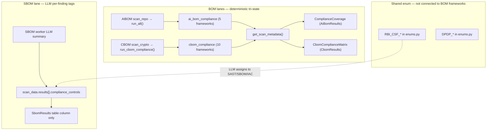
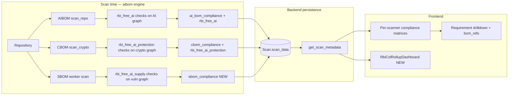
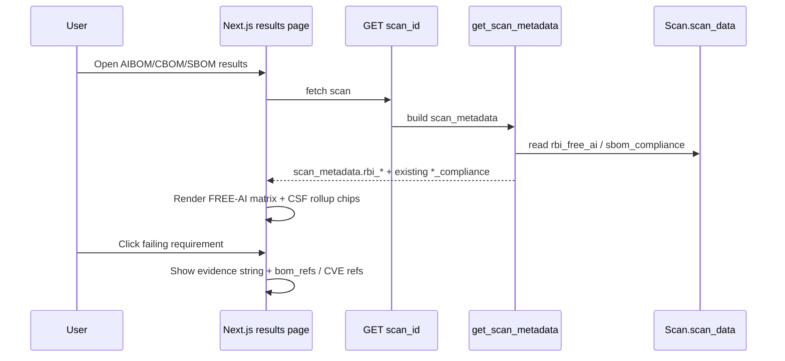
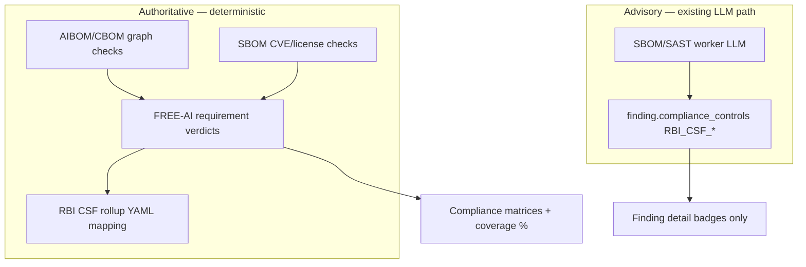

# RBI FREE-AI + CSF Compliance Mapping for AIBOM, CBOM, and SBOM

## Document summary (what the PDF actually is)

The file [`docs/FREEAIR130820250A24FF2D4578453F824C72ED9F5D5851.pdf`](docs/FREEAIR130820250A24FF2D4578453F824C72ED9F5D5851.pdf) is the **RBI FREE-AI** (Framework for Responsible and Ethical Enablement of Artificial Intelligence) committee report — not the standalone RBI Cyber Security Framework (CSF), though they overlap on protection/governance themes.

**Structure in the report:**

| Layer | Content |
|-------|---------|
| **7 Sutras** | Trust, People First, Innovation, Fairness, Accountability, Understandable by Design, Safety/Resilience |
| **6 pillars** | Infrastructure, Policy, Capacity (innovation) + Governance, Protection, Assurance (risk mitigation) |
| **26 recommendations** | Actionable controls (Rec 1–26); Rec 26 explicitly calls for an **AI Compliance Toolkit** |
| **Annexure IV** | Maps 7 existing RBI Master Directions (Outsourcing, Cyber Security 2016, Digital Lending, Customer Service, Fraud Risk, IT Governance 2023, IT Outsourcing) to AI-specific enhancements |

**Key insight for DevSecShield:** Most FREE-AI recommendations are **organizational/process** (board policy, sandboxes, funding, incident reporting). Only a subset is **BOM-evidenceable** from repo scans. Recommendation 26 (“AI Toolkit”) is essentially what the product already does for BOM lanes — the gap is that **RBI is not yet a registered framework** in the deterministic engine.

---

## Current platform state (evidence from codebase)



| Scanner | Framework runner | Metadata key | Results UI | RBI today |
|---------|------------------|--------------|------------|-----------|
| **AIBOM** | [`aibom/compliance/engine.py`](aibom/src/aibom/compliance/engine.py) — 5 frameworks | `ai_bom_compliance` | [`ComplianceCoverage`](frontend/components/ai-bom/AiBomVisualizations.tsx) | None |
| **CBOM** | [`aibom/cbom/compliance.py`](aibom/src/aibom/cbom/compliance.py) — 10 frameworks | `cbom_compliance` | [`CbomComplianceMatrix`](frontend/components/cbom/CbomCryptoCharts.tsx) | None |
| **SBOM** | None | None | Per-finding tags in [`SbomResults.tsx`](frontend/components/SbomResults.tsx) | `RBI_CSF_*` enum via LLM only |

**Hard rules already enforced (must preserve):**
- Compliance checks read the **graph** (components, `properties[]`, edges) — **never** `result.flags` ([`aibom/CLAUDE.md`](aibom/CLAUDE.md) rule #4)
- Tri-state verdicts: `pass`, `fail`, `out_of_scope`, `not_bom_evidenceable`, `na`; coverage = pass/(pass+fail)
- Product ships **no runtime LLM** for BOM enrichment ([`AGENTS.md`](AGENTS.md))

---

## Mapping philosophy: what each BOM can prove for FREE-AI

### Evidence tiers

| Tier | Meaning | UI verdict |
|------|---------|------------|
| **Graph pass/fail** | Deterministic predicate on scan graph | `pass` / `fail` |
| **Manual / NBE** | Process/policy evidence BOM cannot see | `not_bom_evidenceable` (attestable later, AIBOM pattern) |
| **Out of scope** | No relevant artifacts in repo | `out_of_scope` |

~60% of FREE-AI recs (Infra 1–3, Policy 6–9, Capacity 10–13, Governance 14/17, Protection 18/20/22, Assurance 25 process parts) will be **manual/NBE** — honest, not a weakness.

### FREE-AI → BOM responsibility matrix (primary mapping)

| Rec | FREE-AI topic | Primary BOM | Graph-evidenceable checks (examples) | Verdict mix |
|-----|---------------|-------------|--------------------------------------|-------------|
| **4** | Indigenous / sector models | AIBOM | Model inventory present; `name`/`version`; training lineage (`trained_on`) | pass/fail |
| **7** | Fairness / inclusion | AIBOM | `model_card.considerations.fairness_assessments`; dataset `known_bias` | pass/fail + manual |
| **14** | Board AI policy | AIBOM | Reuse NIST RMF GV-1 pattern → NBE | NBE |
| **15** | Data lifecycle / **DPDP** | AIBOM | De-identification on `trained_on` datasets; PHI/BAA edges; retention props if present | pass/fail + NBE |
| **16** | Model governance lifecycle | AIBOM | Model card, hashes, drift (`site:drift_status`), performance metrics, version | pass/fail + NBE |
| **19** | Cybersecurity (AI threats) | **CBOM** + AIBOM | Weak crypto, TLS&lt;1.2, hardcoded keys, quantum-vuln, expired certs; AIBOM secrets | pass/fail |
| **21** | BCP / model degradation | AIBOM | `deployed_at` → `site:drift_status`; monitoring props | pass/fail + NBE |
| **23** | **AI inventory** | AIBOM | `models()` non-empty; dependency graph completeness | pass/fail |
| **24** | AI audit framework | AIBOM | Integrity (`hashes`), license, model card completeness | partial pass/fail |
| **25** | Disclosures | AIBOM | `intended_use`, risk tier documented | partial |
| **26** | AI compliance toolkit | **All three** | Aggregate posture across BOM scans | rollup UI |
| **Supply chain** | Vulnerable/outdated components | **SBOM** | CVE severity, reachability, license category, NTIA SBOM fields | pass/fail (new lane) |

### Annexure IV → BOM mapping (Master Directions cross-walk)

| Annexure IV regulation | AIBOM signals | CBOM signals | SBOM signals |
|------------------------|---------------|--------------|--------------|
| Cyber Security Framework 2016 | Secrets in code, dependency risk | Weak algos, TLS, keys, certs, PQC readiness | Vuln count, critical CVEs |
| Digital Lending 2022 | Fairness assessments, explainability props, de-id training data | Crypto for data-in-transit | Vulnerable crypto libs (e.g. pyjwt, openssl deps) |
| IT Governance 2023 | Model access / serving edges, autonomous-agent flags | Policy files (`java.security`, `openssl.cnf`) | — |
| IT Outsourcing 2023 | `served_by` + `service:baa`, third-party model refs | — | Transitive dep on external SDKs |
| Fraud Risk Management 2024 | Model inventory for fraud ML use cases | — | Outdated fraud-detection libs |
| Outsourcing / Customer Service | BAA edges, consumer-facing model cards | — | — |

### RBI CSF rollup (5 pillars) — layered on FREE-AI

Map each FREE-AI requirement to exactly one CSF pillar for the rollup view:

| CSF pillar | Existing enum | FREE-AI / BOM sources |
|------------|---------------|------------------------|
| **Governance** | `RBI_CSF_GOVERNANCE` | Rec 14, 16, 17, 23, 24, 25; AIBOM inventory + model card |
| **Identification** | `RBI_CSF_IDENTIFICATION` | Rec 23 inventory; SBOM component/CVE inventory; CBOM crypto asset inventory |
| **Protection** | `RBI_CSF_PROTECTION` | Rec 15, 19; CBOM weak crypto/TLS/keys; DPDP security safeguards |
| **Detection** | `RBI_CSF_DETECTION` | Rec 19, 21; drift flags; anomaly-related graph props (mostly NBE) |
| **Response** | `RBI_CSF_RESPONSE` | Rec 22 incident reporting (NBE); BCP fallback (NBE) |

Rollup formula (deterministic): for each CSF pillar, aggregate child FREE-AI requirement verdicts using the same coverage math as existing frameworks (pass/(pass+fail), exclude OOS/NBE from denominator).

---

## Architecture: target integration





---

## Backend implementation plan

### 1. New AIBOM framework: `rbi_free_ai` (primary)

**New file:** [`aibom/src/aibom/compliance/rbi_free_ai.py`](aibom/src/aibom/compliance/rbi_free_ai.py)

- Register in [`aibom/compliance/__init__.py`](aibom/src/aibom/compliance/__init__.py) and add `"rbi_free_ai"` to `FRAMEWORKS` in [`engine.py`](aibom/src/aibom/compliance/engine.py)
- Applicability: `models(r)` non-empty (same gate as EU AI Act) — repos with no AI → entire framework `out_of_scope`
- ~20–25 requirements keyed to FREE-AI recs (e.g. `FREEAI-16-1`, `FREEAI-23-1`), grouped by pillar in `source` field
- **Reuse existing predicates** (do not duplicate logic):
  - Model inventory / lineage → port from [`nist_rmf.py`](aibom/src/aibom/compliance/nist_rmf.py) `MP-1`, `MP-3`
  - Fairness → `ME-2`, [`eu_ai_act_annexIV.py`](aibom/src/aibom/compliance/eu_ai_act_annexIV.py) `EUAIACT-6`
  - De-id / DPDP → `EUAIACT-7`, [`hipaa.py`](aibom/src/aibom/compliance/hipaa.py)
  - Drift / BCP → [`gmlp.py`](aibom/src/aibom/compliance/gmlp.py) `GMLP-10`
  - Third-party / outsourcing → `GV-2` BAA pattern
- Register `@register_manual` for Rec 1–3, 6–13, 17, 18, 20, 22, etc.

**Adapter:** [`aibom/integrations/devsecshield.py`](aibom/src/aibom/integrations/devsecshield.py) already carries `result.compliance` → `ai_bom_compliance` verbatim; new framework auto-includes.

**Metadata:** No change needed — [`scan_metadata.py`](backend/utilities/dashboard/scan_metadata.py) ai_bom branch already surfaces full `ai_bom_compliance`.

### 2. New CBOM framework: `rbi_free_ai_protection` (crypto subset)

**Extend:** [`aibom/src/aibom/cbom/compliance.py`](aibom/src/aibom/cbom/compliance.py)

- Add `rbi_free_ai_protection` to `CBOM_FRAMEWORKS`
- Map Rec 19 + Annexure IV Cyber Security Framework to **existing graph helpers**:
  - `weak_algorithms()`, `weak_protocols()`, `hardcoded_key_material()`, `undersized_keys()`, `under_strength(112)` (DPDP security floor proxy), `quantum_vulnerable()`, `self_signed_certs()`
- Applicability: shared `_has_crypto` gate (already exists)
- Manual rows for incident reporting protocols, red-team process (NBE)

**Worker restart required** after aibom CBOM changes (per project conventions).

### 3. New SBOM compliance lane: `sbom_compliance` (largest new work)

Today SBOM has **no** framework runner — only LLM `compliance_controls` dicts on findings.

**New module:** `aibom/src/aibom/compliance/sbom_rbi.py` (or `integrations/sbom_devsecshield.py` adapter)

Deterministic checks over normalized SBOM scan output (not LLM):

| Requirement | Predicate on SBOM findings graph |
|-------------|----------------------------------|
| FREEAI-ID-1 Component inventory | Every direct dep has name + version |
| FREEAI-ID-2 Known vulns tracked | Critical/high CVE count = 0 (or threshold) |
| FREEAI-PROT-1 No known-exploited vulns | CISA KEV / critical CVE filter |
| FREEAI-PROT-2 License risk | No strong/network copyleft in production path (reuse `LicenseCategory`) |
| FREEAI-PROT-3 Crypto lib hygiene | Flag deps matching crypto allowlist with open CVEs |
| Annex IV outsourcing | Transitive deps on unaudited external packages (heuristic: unknown publisher) |

**Integration path:**
- Option A (recommended): Add lightweight `normalize_sbom()` in aibom that builds a minimal `ScanResult`-like component list from worker output, then `run_framework(result, "rbi_free_ai_supply")`
- Option B: Run checks in backend post-scan on `scan_data.results` (faster to prototype, breaks single-engine pattern)

Persist as `sbom_compliance` in `scan_data`; surface in [`scan_metadata.py`](backend/utilities/dashboard/scan_metadata.py) sbom_sca branch (currently only repo_url/branch).

**Keep existing LLM `compliance_controls`** as supplementary per-finding tags — do not remove. Add optional back-link: `finding.compliance_controls` may include `RBI_CSF_PROTECTION` when a CVE maps to a failing FREEAI-PROT requirement (deterministic post-pass, not LLM).

### 4. CSF rollup object (backend aggregation)

**New:** `backend/utilities/dashboard/rbi_posture.py`

```python
# Pseudocode shape
{
  "rbi_csf_rollup": {
    "governance": { "pass": 3, "fail": 1, "coverage": 0.75, "sources": ["ai_bom:FREEAI-16-*", ...] },
    "identification": { ... },
    "protection": { ... },
    "detection": { ... },
    "response": { ... }
  },
  "disclaimer": ADVISORY_DISCLAIMER
}
```

- Input: `ai_bom_compliance`, `cbom_compliance`, `sbom_compliance` from one or more scans (team-level endpoint) OR single-repo if all three scan types exist
- Mapping table: static YAML `config/rbi-csf-rollup.yaml` — requirement ID → CSF pillar (no AI inference)

**New API (optional phase 2):** `GET /{team_id}/rbi-posture?repo=...` aggregating latest successful AIBOM+CBOM+SBOM scans for same repo.

### 5. Contract tests

| Test | Location |
|------|----------|
| RBI FREE-AI registry counts + no-flag-read | `aibom/tests/test_rbi_free_ai_compliance.py` |
| CBOM protection annex | extend `test_cbom_compliance_expanded.py` |
| SBOM compliance shape | `backend/tests/test_sbom_compliance_contract.py` |
| Metadata surfacing | extend `test_cbom_scan_metadata_contract.py` pattern for sbom |
| FE label lock | extend `test_cbom_chart_data_contract.py` / new `test_rbi_chart_contract.py` |
| CSF rollup math | `backend/tests/test_rbi_csf_rollup.py` |

---

## Frontend implementation plan

### 1. Per-scanner FREE-AI matrix (extend existing components — no new aesthetic)

| Page | Change |
|------|--------|
| [`AiBomVisualizations.tsx`](frontend/components/ai-bom/AiBomVisualizations.tsx) | Add `rbi_free_ai` to `FRAMEWORK_LABELS`; optional pillar filter chips (Infrastructure / Governance / …) mirroring [`CbomComplianceMatrix`](frontend/components/cbom/CbomCryptoCharts.tsx) group filter pattern |
| [`CbomCryptoCharts.tsx`](frontend/components/cbom/CbomCryptoCharts.tsx) | Add `rbi_free_ai_protection` label; render in Regulatory group |
| [`SbomResults.tsx`](frontend/components/SbomResults.tsx) | **New** `SbomComplianceMatrix` component (copy `ComplianceCoverage` pattern); gate on `scanMetadata.sbom_compliance` |

Types: extend [`frontend/utils/backend_api.ts`](frontend/utils/backend_api.ts) with `sbom_compliance?` and shared `FrameworkCoverage` type.

### 2. RBI CSF rollup dashboard (new, layered view)

**New component:** `frontend/components/rbi/RbiCsfRollup.tsx`

- 5 horizontal bars (Governance → Response) — same verdict palette as AIBOM/CBOM matrices
- Click pillar → shows contributing FREE-AI requirements from all three BOMs with scanner badge (AIBOM/CBOM/SBOM)
- Link to underlying scan results pages

**Placement options:**
- Team dashboard [`app/[team_id]/page.tsx`](frontend/app/[team_id]/page.tsx) — new "RBI Posture" card when ≥1 BOM scan has RBI data
- Optional unified `/[team_id]/rbi-posture` route for multi-scan aggregation

### 3. Per-finding connection (findings ↔ requirements)

On drilldown rows that have `refs` (bom_refs) or CVE IDs:
- AIBOM/CBOM: click ref → scroll to component in findings table (existing `bom_ref` pattern)
- SBOM: click CVE → open finding detail panel
- Show `RBI_CSF_*` enum label via existing [`owasp-compliance-labels.ts`](frontend/lib/owasp-compliance-labels.ts) as secondary tag when rollup mapping exists

---

## Static frontend vs backend logic vs Bedrock — decision

| Approach | Verdict |
|----------|---------|
| **Static frontend only** (hardcoded requirement text + fake pass/fail) | **Reject** — violates existing architecture; no scan-time evidence; cannot show `refs` or coverage math; dishonest for Rec 26 toolkit positioning |
| **Backend deterministic logic** (aibom compliance engine) | **Required** — matches AIBOM/CBOM precedent; testable; CI-gatable; produces `coverage` metrics |
| **Bedrock / LLM for framework pass/fail** | **Reject for BOM frameworks** — non-deterministic, violates product rule ("no runtime LLM" for enrichment); existing SBOM LLM tags remain **advisory only**, not coverage denominator |
| **Bedrock for SBOM per-finding tags** | **Keep as-is** (already in [`summary_manager.py`](RabbitMQ/worker/helpers/tools/sca_sbom_agent/summary_manager.py)) — useful narrative, but secondary to deterministic `sbom_compliance` |

**Recommended split:**



---

## Phased delivery

### Phase 1 — AIBOM `rbi_free_ai` + FE matrix (highest value, lowest risk)
- Implement ~12 graph checks + ~12 manual rows covering Rec 15, 16, 21, 23, 24, 25, 7
- FE: extend `ComplianceCoverage` labels + pillar filters
- Tests + worker restart

### Phase 2 — CBOM `rbi_free_ai_protection` + Annexure IV cyber mapping
- Compose existing crypto predicates into RBI protection framework
- FE: one new row in `CbomComplianceMatrix` regulatory group

### Phase 3 — SBOM `sbom_compliance` deterministic lane
- `normalize_sbom` + supply-chain checks
- `scan_metadata` + `SbomComplianceMatrix`
- Bridge critical CVE findings to `RBI_CSF_PROTECTION` deterministically

### Phase 4 — CSF rollup + unified RBI posture view
- `rbi-csf-rollup.yaml` + `rbi_posture.py` aggregator
- `RbiCsfRollup.tsx` on team dashboard
- Optional multi-scan API endpoint

### Phase 5 — Cross-BOM "AI Toolkit" export (Rec 26)
- PDF section in [`backend/utilities/pdf/`](backend/utilities/pdf/) combining three BOM compliance summaries for same repo
- Extends existing BOM export pattern ([`test_bom_export.py`](backend/tests/test_bom_export.py))

---

## Risks and mitigations

| Risk | Mitigation |
|------|------------|
| Over-claiming compliance (FREE-AI is mostly process) | Heavy use of `not_bom_evidenceable` + advisory disclaimer; never imply regulatory certification |
| SBOM lacks graph model today | Introduce minimal `ScanResult` adapter; don't force-fit into AIBOM scanners |
| FE label drift | Contract test locking `FRAMEWORK_LABELS` ↔ `FRAMEWORKS` keys (C3/F3 precedent) |
| Duplicate logic with NIST/EU checks | Import/reuse predicates; RBI framework is a **view** over same graph facts |
| User expects RBI CSF = FREE-AI | UI shows both: FREE-AI detail matrix + CSF rollup banner explaining relationship |

---

## Files to touch (summary)

**aibom (engine):**
- NEW `aibom/src/aibom/compliance/rbi_free_ai.py`
- EDIT `aibom/src/aibom/compliance/engine.py`, `__init__.py`
- EDIT `aibom/src/aibom/cbom/compliance.py`
- NEW `aibom/src/aibom/integrations/sbom_devsecshield.py` (or equivalent)
- NEW `aibom/config/rbi-csf-rollup.yaml`
- NEW tests under `aibom/tests/test_rbi_*.py`

**backend:**
- EDIT `backend/utilities/dashboard/scan_metadata.py` (sbom_compliance)
- NEW `backend/utilities/dashboard/rbi_posture.py`
- OPTIONAL new router endpoint for team rollup

**frontend:**
- EDIT `AiBomVisualizations.tsx`, `CbomCryptoCharts.tsx`, `SbomResults.tsx`
- NEW `frontend/components/rbi/RbiCsfRollup.tsx`
- EDIT `frontend/utils/backend_api.ts`, `owasp-compliance-labels.ts` (FREE-AI requirement labels)

**worker:**
- EDIT `RabbitMQ/worker/scan_worker.py` sbom task to persist `sbom_compliance` if computed in worker path
